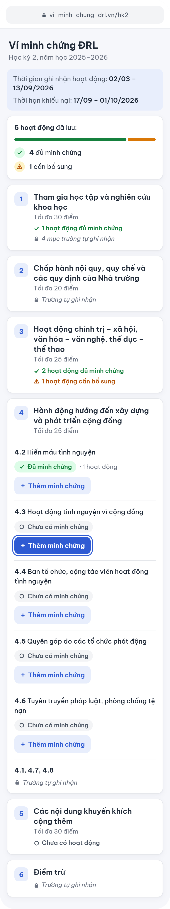
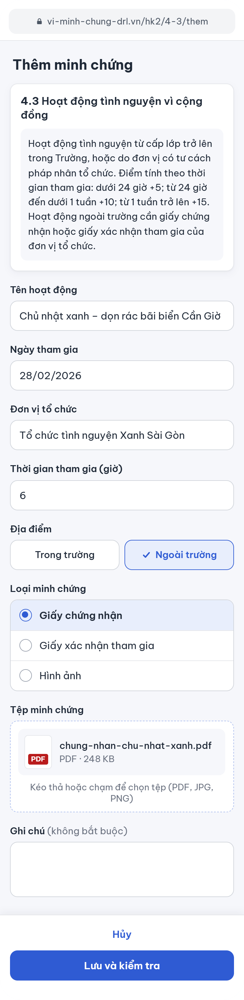
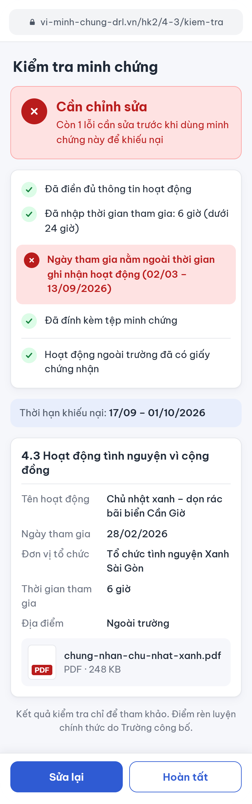

# PA#1 – Idea and Wireframe: Ví minh chứng ĐRL (ĐRL Evidence Wallet)

Course: Web Application Development (CSC13008) · Class: 24KTPM1

## 1. Team

| No. | Full name          | Student ID |
| --- | ------------------ | ---------- |
| 1   | Lê Nguyễn Quốc Học | 24127044   |
| 2   | Thái Quang Huy     | 24127177   |
| 3   | Trần Hoàng Phúc    | 24127505   |

## 2. The Problem

Every semester, HCMUS students take part in volunteer work, competitions, seminars, and club activities that may count toward their training points (Điểm rèn luyện, ĐRL). Some activities require evidence such as certificates or organizer confirmations, but these files end up scattered across phone galleries, downloads, email, and chat. When the school publishes the preliminary ĐRL result and students have about two weeks to appeal missing items, they may discover too late that the evidence is missing, that the activity falls outside the counted period, or that they cannot tell which ĐRL item it belongs to. The problem is keeping each activity and its evidence organized under the correct ĐRL item, and knowing early whether the record has everything it needs.

## 3. Users

| User          | What they are trying to get done                                                                                                                                                                                                               |
| ------------- | ---------------------------------------------------------------------------------------------------------------------------------------------------------------------------------------------------------------------------------------------- |
| HCMUS student | Record each activity with its evidence under the correct ĐRL item, check early whether the record is complete according to the app's checklist, and have the evidence ready when the preliminary result comes out and the appeal window opens. |

## 4. Main flow

Main job: turn an activity the student has just taken part in into a saved record, under the right ĐRL item, with evidence complete enough to use in an appeal.

1. The student signs in and opens the current semester; its activity period and appeal window are already stored. *(not drawn)*
2. On "Danh sách minh chứng học kỳ" (Semester evidence checklist), the student finds the ĐRL item the activity belongs to and taps "Thêm minh chứng" (Add evidence). *(Screen 1)*
3. On "Thêm minh chứng" (Add evidence), the student enters the activity details and any field the item needs (for example the hours taken part, for item 4.3), attaches the certificate or confirmation file, and taps "Lưu và kiểm tra" (Save and check). *(Screen 2)*
4. On "Kiểm tra minh chứng" (Evidence check), the app checks the record against the item's rules and shows "Đủ minh chứng" (Enough evidence) or "Cần chỉnh sửa" (Needs changes), with exactly what is missing. The student either fixes it with "Sửa lại" (Edit) or keeps it with "Hoàn tất" (Done) and returns to the checklist, where the item's status is updated. *(Screen 3)*
5. When the school publishes the preliminary ĐRL result, the student marks each saved activity as counted or missing, and uses the list of missing activities, each with its evidence, to file appeals on Shub before the appeal window closes. *(not drawn; the appeal itself is filed outside the app)*

## 5. Scope

### Building

- Student registration and login with email and password.
- One predefined semester (activity period and appeal window) and the ĐRL groups and items of the current HCMUS regulation, seeded in the database; no admin page for managing them.
- Create, view, edit, and delete activity records: activity name, date, organizer, location (on-campus or off-campus), ĐRL item, item-specific fields such as hours for item 4.3, and an optional note.
- One or more evidence files (image or PDF) per activity, each with an evidence type chosen by the student (certificate, participation confirmation, or photo); only the owner can open them.
- A small set of fixed rules checked for each record: required fields are filled, the date is within the activity period, at least one evidence file exists, an off-campus activity has a certificate or confirmation, and item-specific fields are filled.
- Each record is shown as **"Đủ minh chứng" (Enough evidence)** or **"Cần chỉnh sửa" (Needs changes)**, with the missing requirements listed. On the checklist, each item shows "Đủ minh chứng", "Cần bổ sung" (Needs more evidence) or "Chưa có minh chứng" (No evidence yet); items recorded by the school are labelled "Trường tự ghi nhận".
- After the preliminary result, the student marks each activity as counted or missing and sees the list of missing activities to appeal, with their evidence.
- A responsive, mobile-first interface.

### Not building

- No ĐRL score calculation or prediction.
- No automatic appeal submission and no integration with Shub, hcmus.drl.vn, or other HCMUS systems.
- No HCMUS SSO.
- No AI/OCR for reading certificates or evidence files.
- No certificate authenticity verification.
- No administrator interface for editing ĐRL items and no automatic scraping or updating of ĐRL regulations.
- No storage of personal-circumstance data (items 5.7–5.11, such as orphan or low-income household status).
- No native mobile app.
- No email, SMS, or push notifications.

## 6. Screens

The three screens below follow one another in the main flow. They are a mockup (colours and sample content) rather than a grey-box wireframe; only the flow is meant to be assessed. They are shown as full pages at mobile width (390 px): it is a responsive web app opened in the phone's browser, and on a phone the user scrolls down to see the rest of the page. Screen names and button labels are kept in Vietnamese, exactly as they appear in the drawings, with an English translation in brackets.

The whole flow, with arrows from each button to the screen it opens:

### Screen 1 – "Danh sách minh chứng học kỳ" (Semester evidence checklist)

The student has just taken part in an activity and wants to see which saved activities already have enough evidence and which do not, then pick the ĐRL item the new activity belongs to. The top of the page shows the activity period and a predefined reference appeal window for the current semester, together with a summary of the saved activities: 5 saved, 4 with enough evidence and 1 needing more. This reference information is stored for the semester and is not live-synced with HCMUS systems. Below are the six ĐRL groups of the school's current regulation. Tapping a collapsed group card (1, 2, 3, 5 or 6) expands it to show its items in the same way as group 4. Items marked "Trường tự ghi nhận" (recorded by the school) have no button, because the student does not submit anything for them. Each other item has a "Thêm minh chứng" (Add evidence) button, which opens Screen 2 for that item, for example item 4.2 "Hiến máu tình nguyện" (blood donation). In the drawing the student taps it on item 4.3 "Hoạt động tình nguyện vì cộng đồng" (community volunteering), which has no evidence yet.

### Screen 2 – "Thêm minh chứng" (Add evidence)

The student records one real activity and its proof under the item chosen on Screen 1. The card at the top repeats the rule of item 4.3 so the student knows what is needed before filling in the form: volunteering is scored by the hours taken part (under 24 hours, 24 hours to under a week, or a week or more), and an off-campus activity needs a certificate or a participation confirmation from the organizer. The student enters the activity name, the date, the organizer and the number of hours, chooses "Ngoài trường" (off-campus) and "Giấy chứng nhận" (certificate), and taps the upload area, which opens the device's file picker (PDF, JPG or PNG). "Hủy" (Cancel) returns to Screen 1 without saving anything. "Lưu và kiểm tra" (Save and check) saves the activity and opens Screen 3.

### Screen 3 – "Kiểm tra minh chứng" (Evidence check)

The student wants to know whether this record is complete according to the app's predefined checklist. The app checks the saved information against the predefined rules for this semester and shows the result at the top: here "Cần chỉnh sửa" (Needs changes), because 28/02/2026 is outside the configured activity period (02/03 – 13/09/2026). The other rules pass: the details are complete, the hours are entered (6 hours, under 24 hours), a file is attached, and the off-campus activity has a certificate. Below are the predefined reference appeal window for the semester and a summary of what was saved. A note reminds the student that the check is for reference only and the official ĐRL result comes from the school. "Sửa lại" (Edit) goes back to Screen 2 with all fields still filled in, so the student can correct the date. "Hoàn tất" (Done) keeps the record and returns to Screen 1, where item 4.3 now shows "Cần bổ sung" (Needs more evidence) and the summary becomes 6 saved activities: 4 with enough evidence and 2 needing more. When every rule passes, the banner instead shows "Đủ minh chứng" (Enough evidence), and after "Hoàn tất" the item shows the same status on Screen 1.