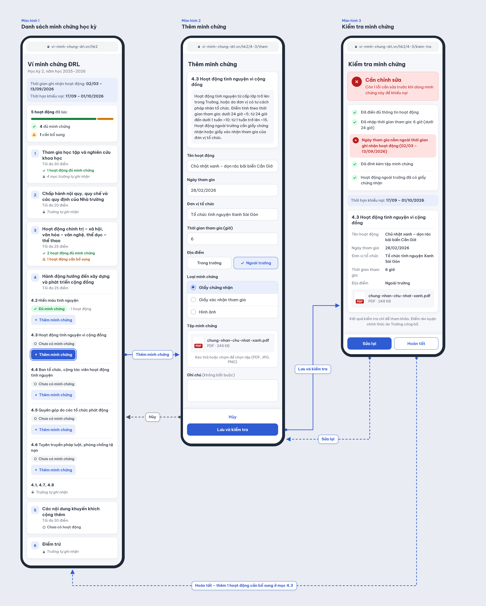

# ĐRL Evidence Wallet — Ví minh chứng ĐRL

A proposed responsive web app that helps HCMUS students organize activity records and supporting evidence under the correct ĐRL item for one predefined semester, check whether each record meets a predefined checklist, and keep evidence ready for the appeal window after preliminary training-point results are published.

Course: **Web Application Development (CSC13008)** · Class: **24KTPM1**

Current assignment: **PA#1 — Idea and Wireframe**

## Team

| Full name | Student ID |
| --- | --- |
| Lê Nguyễn Quốc Học | 24127044 |
| Thái Quang Huy | 24127177 |
| Trần Hoàng Phúc | 24127505 |

## The problem

Activity certificates, participation confirmations, and photos may be kept in different places such as students' phones, downloads, and messages. When an activity is missing from the preliminary ĐRL result, students need to find its evidence and check its date and applicable ĐRL item before the appeal window closes.

The proposed app keeps these records together and identifies missing information early. Its checklist checks entered fields and user-selected evidence types, not file contents or authenticity; the official ĐRL result comes from the school.

## Main flow and mockups

After signing in, the student follows the three-screen flow:

1. Open the semester checklist and choose an ĐRL item.
2. Add an activity, enter its details and item-specific fields, attach evidence, and select "Lưu và kiểm tra" (Save and check).
3. Review the checklist result, use "Sửa lại" (Edit) to correct the record, or select "Hoàn tất" (Done) to keep it and return to the semester checklist with its status updated.

The example follows an off-campus volunteering activity under item 4.3. Its date, 28/02/2026, is outside the configured activity period of 02/03–13/09/2026, so the result explains why the record needs changes.



| Screen | Purpose | File |
| --- | --- | --- |
| Danh sách minh chứng học kỳ | Review saved evidence and choose an item to add an activity. | [Screen 1](wireframes/screen-1.png) |
| Thêm minh chứng | Enter activity details and attach a certificate, confirmation, or photo. | [Screen 2](wireframes/screen-2.png) |
| Kiểm tra minh chứng | Review the rule checks, edit the record, or return to the checklist. | [Screen 3](wireframes/screen-3.png) |

Open the PNG files directly or view them through the links above. They are static, full-page mockups at mobile width; navigation is shown by the arrows in the flow image. No installation, dependencies, or server are required to review them. The [proposal](PROPOSAL.md#6-screens) explains each screen and its actions.

## Planned scope

- Email and password registration and login.
- One predefined semester, with a stored activity period and appeal window, and seeded ĐRL groups and items from the current HCMUS regulation.
- Create, view, edit, and delete personal activity records: name, date, organizer, on-campus or off-campus location, ĐRL item, item-specific fields such as volunteering hours, and an optional note.
- Attach one or more images or PDFs per activity, each with a student-selected evidence type (certificate, participation confirmation, or photo); only the owner can open the files.
- Use fixed rules to check required fields, dates within the activity period, at least one evidence file, a file labelled as a certificate or participation confirmation for off-campus activities, and item-specific fields.
- Show each record as "Đủ minh chứng" (Enough evidence) or "Cần chỉnh sửa" (Needs changes), with missing requirements listed; show item-level checklist statuses and label school-recorded items "Trường tự ghi nhận".
- Provide a responsive interface designed for use on phones.

The summary counts saved activities. For supported ĐRL items, the checklist shows "Chưa có minh chứng" (No evidence yet) when no activities are saved, "Cần bổ sung" (Needs more evidence) when any saved activity fails a check, and "Đủ minh chứng" when at least one activity is saved and all saved activities pass. These statuses describe checklist completeness, not university acceptance.

Last priority, only if time allows: after preliminary results are published, let students mark each saved activity as counted or missing and view missing activities with their evidence. Students file appeals through the school's own process outside the app.

The scope excludes score calculation or prediction, automatic appeal submission, school-system integration or SSO, AI/OCR, certificate authenticity verification, regulation administration or automatic updates, personal-circumstance records, native mobile apps, and notifications. See the [full scope](PROPOSAL.md#5-scope) for details.

## Current status

This repository contains the project proposal, three screen mockups, a flow diagram, an AI usage log, and a self-assessment. Application implementation and technology selection are pending. Authentication, storage, uploads, and rule checks described above are planned features.

Sign-in and the optional, last-priority counted/missing activity workflow are described in the proposal but are outside the three illustrated screens. The activity period and appeal window shown in the mockups are predefined reference data, with no live connection to HCMUS systems.

## Repository guide

```text
README.md                     Project overview
PROPOSAL.md                   Team, problem, users, main flow, scope, and screens
AI-LOG.md                     AI use, attribution, and decisions about output
SELF_ASSESSMENT_REPORT.md     Scores, evidence, and remaining work
wireframes/
  flow.png                    Three-screen flow with navigation arrows
  screen-1.png                Semester evidence checklist
  screen-2.png                Add evidence
  screen-3.png                Evidence check
```
